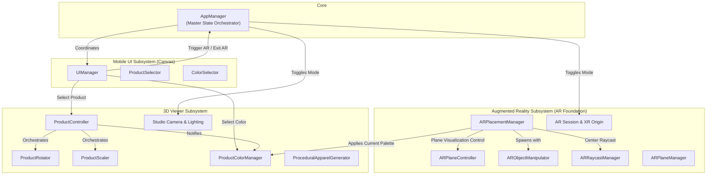

# MerchAR — Technical Architecture Document

## 1. Executive Summary

**MerchAR** is a lightweight, mobile-first Android application developed in Unity 6 using Universal Render Pipeline (URP), AR Foundation, and Google ARCore. It provides users with an offline, interactive 3D merchandise showroom that smoothly transitions into real-world Augmented Reality plane tracking and placement.

---

## 2. System Architecture Diagram

---

## 3. Subsystem Breakdown

### 3.1 Core Architecture (`MerchAR.Core`)
- **`AppManager.cs`**:
  - Implements the state machine toggling between `AppMode.Viewer3D` and `AppMode.AugmentedReality`.
  - Checks Android runtime permissions (`UnityEngine.Android.Permission.Camera`).
  - Queries `ARSession.CheckAvailability()` to gracefully inform users if ARCore is unsupported without crashing.
  - Dynamically activates/deactivates the Studio Camera/lighting rig and the XR Origin/AR Session.

### 3.2 Product & Customization Architecture (`MerchAR.Product`)
- **`ProductController.cs`**:
  - Singleton registry holding serialized `ProductItem` entries (T-Shirt, Hoodie).
  - Handles switching active models, default local transforms, and view resets.
  - Fires `OnProductChanged` event.
- **`ProductRotator.cs`**:
  - Smooth 360° turntable rotation using mobile swipe or mouse drag.
  - Employs inertia damping (`Mathf.Lerp`) and optional auto-spin idle animation.
  - Checks `EventSystem.current.IsPointerOverGameObject` to prevent touch-through from UI.
- **`ProductScaler.cs`**:
  - Dual-finger pinch-to-zoom and mouse scroll wheel zoom.
  - Clamps scale within safe viewing bounds (`0.5x` to `2.2x`).
- **`ProductColorManager.cs`**:
  - Manages the 6 curated e-commerce colors: **Black, White, Red, Blue, Green, Purple**.
  - Employs `MaterialPropertyBlock` targeted at `_BaseColor` (URP) and `_Color` (legacy).
  - **Memory & Integrity Safe:** Does not instantiate clone materials or modify shared project assets permanently on disk.
- **`ProceduralApparelGenerator.cs`**:
  - Standalone in-engine procedural mesh generator.
  - Generates T-shirt and Hoodie meshes algorithmically (torso, sleeves, collar, front kangaroo pocket, hood) with full UV mapping and vertex normals directly inside the Unity Editor without any external dependencies.

### 3.3 Augmented Reality Subsystem (`MerchAR.AR`)
- **`ARPlacementManager.cs`**:
  - Continuous screen-center raycasting using `ARRaycastManager.Raycast()` against `TrackableType.PlaneWithinPolygon`.
  - Positions and rotates the visual placement reticle indicator flush against the detected surface.
  - Spawns the selected merchandise on tap, facing the user horizontally (`LookRotation`).
  - Applies the active color palette automatically upon instantiation.
- **`ARPlaneController.cs`**:
  - Listens to placement events and hides detected plane polygon visualizers once merchandise is placed for a clean, immersive look.
- **`ARObjectManipulator.cs`**:
  - Attached directly to placed merchandise instances.
  - Single-finger horizontal drag rotates the placed model around its Y-axis.
  - Two-finger pinch scales the placed model realistically on the floor/tabletop.
  - Two-finger twist rotates the placed object.

### 3.4 User Interface Subsystem (`MerchAR.UI`)
- **`UIManager.cs`**:
  - Controls visibility between `ViewerPanel` and `ARPanel`.
  - Displays context-sensitive AR status banners ("Point camera at flat surface", "Surface detected! Tap to place", "Model placed: swipe to rotate").
  - Houses the Toast notification banner for permission warnings or tracking status.
- **`ProductSelector.cs`**:
  - Intercepts clicks on "T-Shirt" and "Hoodie" buttons, toggles visual selection state, and notifies `ProductController`.
- **`ColorSelector.cs`**:
  - Populates color swatches, manages the visual selection ring around active swatches, and routes selections to `ProductColorManager`.

---

## 4. 3D Asset Pipeline

MerchAR provides two distinct 3D generation pathways:
1. **Standalone Pure-Python OBJ Generator (`Tools/PythonStandalone/generate_apparel_obj.py`)**:
   - Zero-dependency Python 3 script.
   - Generates production-ready Wavefront `.obj` and `.mtl` files directly into `Assets/Models/Generated/` (`TShirt.obj`, `Hoodie.obj`).
2. **Blender Headless Automation (`Tools/Blender/generate_tshirt.py`, `generate_hoodie.py`)**:
   - Headless Blender Python scripts targeting FBX export with custom materials and UV smart projection.
3. **Unity C# Procedural Generation (`ProceduralApparelGenerator.cs`)**:
   - Fallback generator working completely inside Unity at edit-time or runtime.
